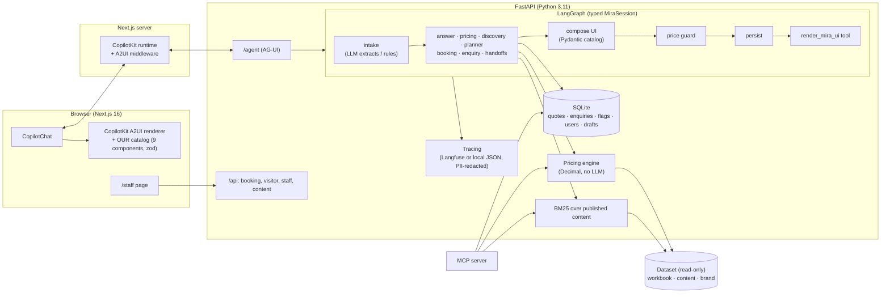

# Mira: the Ceylon Compass Holidays booking assistant

Mira chats with a traveller, works out the trip, draws its own interface, quotes prices that come only from a deterministic pricing engine, hands anything it can't price to a specialist with a staff flag, and proves all of this with an automated evaluation suite and per-turn traces.

Take-home assignment for Alt SourceCode (Gen AI Full Stack Engineer Intern).

## Run it (one command)

Needs Python 3.11 and Node 18+ (tested on Windows 11, Node 24).

```powershell
copy .env.example .env      # optional: add GEMINI_API_KEY and Langfuse keys
python scripts/dev.py
```

- Chat: http://localhost:3000 · Staff page: http://localhost:3000/staff (demo users `staff` / `staff-demo`, `approver` / `approver-demo`)
- First run creates `.venv`, installs the pinned Python packages and the npm packages (a few minutes).
- **No key needed to run.** Without `GEMINI_API_KEY`, Mira runs in *offline mode* (rule-based understanding, extractive answers from content). Prices, flags, UI and guards are identical in both modes, because none of them use the model.

Other commands:

| Command | What it does |
|---|---|
| `pytest` | 255 unit tests (no LLM, no network): pricing, loaders, guard, privacy, agent, API permissions, MCP, dataset hashes |
| `python -m evals.run` | Evaluation suite → `reports/eval_report.md` (+ JSON, + `reports/history/`) |
| `python -m evals.run --tag pricing` | Just the pricing/flag cases (for the live margin change) |
| `python -m mira.pricing T09 2027-04-12 --adults 2 --children 7 10` | Staff price breakdown from the engine |
| `python -m mira.chat --all-seeds` | Replays the 17 seed conversations in the terminal |
| `python -m mira.data` | Loads the dataset and lists every data issue it found |
| `python scripts/adversarial.py` | 20 adversarial inputs; fails if any invented amount appears |
| `python -m mira.mcp_server` | Bonus MCP server (stdio): `search_tours`, `get_quote`, `create_enquiry` |

## Architecture



**The three layers, in one sentence each:** LangGraph decides *what the agent does*; AG-UI is *how the agent and the browser talk* (an event stream); A2UI is *what gets drawn*: declarative JSON that may only use components from our catalog.

One message, end to end:
1. `intake` reads the message. With a key, Gemini fills a strict JSON schema (intent, tour, adults, child ages, date); otherwise regular expressions do. **Code validates every value** (an invented or draft tour id is dropped; tours are resolved in code).
2. Code picks the route. Quotes go to `pricing`, which calls `mira.pricing.quote()`, a pure `Decimal` function. The model never sees or writes a price.
3. `compose` validates each UI component against the Pydantic catalog; `guard` checks every money amount in the text **and** the UI against the engine's values; `persist` saves quotes/enquiries/flags and closes the turn's trace.
4. The `render_mira_ui` ToolNode emits a `TOOL_CALL_RESULT` with A2UI v0.9 operations; CopilotKit's A2UI middleware turns it into an `a2ui-surface`; the browser renders it with our components, which re-validate with zod.

## Main design decisions (details in [docs/DECISIONS.md](docs/DECISIONS.md))

- **Rules in code, not prompts.** Pricing, the price guard, permissions, publishing, routing and tour resolution are deterministic Python. The LLM only extracts details and writes wording.
- **Two quote schemas.** `QuoteInternal` (cost, GP%) is stored for staff; `QuoteForTraveller` has no cost/margin fields and forbids extra fields. UI components only accept it.
- **Fixed vs dynamic A2UI surfaces.** PriceBreakdown, BookingForm, SpecialistHandoff and EnquiryConfirmation use layouts we wrote (`mira/ui/schemas/*.json`) bound to data filled by code; TourCard, TourShelf, ItineraryDay, TravellerPicker and SourceCitation are chosen per turn by the graph.
- **Text before cards.** Mira's guarded text is emitted before the UI tool result; `mira/agui.py` works around a CopilotKit 0.1.97 bug that dropped those text events.
- **The A2UI renderer is our catalog only** (`includeBasicCatalog: false`, `injectA2UITool: false`): the model cannot draw arbitrary UI.
- **No valid rate, no price.** The engine returns `NoQuote(reason)`; Mira hands over and a staff flag is saved.
- **Hand-written BM25** over published, cleaned content (drafts excluded, HTML comments stripped, superseded lines replaced by pointers to the newer policy, injection/discount lines removed).
- **Offline mode** keeps the whole system (and CI) working without an API key, and gives the evals a deterministic baseline.

## Evaluation (latest: [reports/eval_report.md](reports/eval_report.md))

55 cases (17 seeds loaded unchanged + 38 of ours, 9 multi-turn), each tagged with requirements. Code checks wherever there is an exact answer (price **consistency**: shown = engine; **golden**: engine = brief; no invented amounts; flags raised; UI payloads valid; no draft content; no cost/margin leaks; PII absent from traces). An LLM judge using a different model scores behaviour, calibrated against 10 cases labelled by hand (`evals/human_labels_template.jsonl` → `python -m evals.labels agreement`). Price and flag cases run 3× and the worst run counts.

The problem found and fixed through the evals: [docs/FIXED_PROBLEM.md](docs/FIXED_PROBLEM.md) (a tour mentioned in passing was priced instead of the tour asked about).

## Data issues

The dataset is loaded as-is and never modified (a SHA-256 test checks every file). 45 issues are recorded with their handling in [docs/DATA_AUDIT.md](docs/DATA_AUDIT.md). The key ones: H02 text rate (parsed), H08 text date (parsed), H10 rates in USD, H04 no single room → no price for solo travellers on T12, H07 expired → no price for T11, H03 overlapping Peak rows → no price for 1 Jan to 31 Mar 2027 (awaiting Sales), T10/T16 no rates, T15 draft, T14 stale promotion (not quotable), T06 duration conflict (priced as a 1-day tour + staff flag), newer policies override older page terms (P02, P03), no photos (placeholder), rates end 31 Oct 2027.

Screenshots (desktop and 375px mobile): [docs/screenshots/](docs/screenshots/). Full requirement-by-requirement review: [docs/SYSTEM_REVIEW.md](docs/SYSTEM_REVIEW.md).

## Known limitations (honest)

- **Real LLM numbers are pending a key.** The latest committed report is from offline mode. The judge is reported as *skipped* (not passed) without a key, and the judge–human agreement needs your 10 labels plus a judge run.
- Offline answers are extractive (they quote the relevant passages) rather than conversational; with Gemini they are written in Mira's voice from the same passages.
- Search is BM25 without synonyms; tour resolution adds a small synonym list, and ambiguous requests fall back to discovery questions.
- Mira replies arrive as one message (no token streaming), because replies are composed and guarded in code before they are sent.
- Staff auth is a demo (two seeded users, HMAC tokens); A2UI uses v0.9 because that is what the pinned CopilotKit renderer speaks (the spec's v1.0 is newer).
- The H03 conflict and the T06 duration decision are judgement calls pending Sales confirmation.

## AI tools used

Claude Code (Anthropic) generated most of the code and docs under my direction, phase by phase; I reviewed it and can explain and change any part. Details and the list of AI-generated files: [docs/AI_USAGE.md](docs/AI_USAGE.md).

## Repository map

`mira/data` loaders · `mira/pricing` engine + CLI · `mira/retrieval` search + grounding · `mira/agent` graph, nodes, guard, rules · `mira/ui` A2UI catalog + operations · `mira/api.py` FastAPI · `mira/content_agent.py` drafts + approval · `mira/mcp_server.py` · `frontend/` Next.js · `evals/` suite + judge + labels · `tests/` · `docs/` plan, audit, decisions, demo script.
