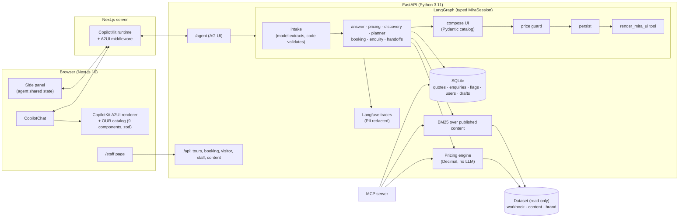

# Mira: the Ceylon Compass Holidays booking assistant

Mira chats with a traveller, works out the trip, draws its own interface from a fixed component catalog, and quotes prices that come **only** from a deterministic pricing engine. Anything it can't price goes to a specialist with a staff flag. An automated evaluation suite (real model + LLM judge) and per-turn Langfuse traces back up every claim below.

Take-home assignment for Alt SourceCode (Gen AI Full Stack Engineer Intern).

## Run it (one command)

Needs Python 3.11 and Node 18+ (tested on Windows 11, Node 24).

```powershell
copy .env.example .env      # optional: add DEEPSEEK_API_KEY (or GEMINI_API_KEY) and the Langfuse keys
python scripts/dev.py
```

- **Chat:** http://localhost:3000
- **Staff page:** http://localhost:3000/staff. Demo users are `staff` / `staff-demo` (enquiries, cost and GP%, flags, notes, drafts) and `approver` / `approver-demo` (can also publish drafts).
- The first run creates `.venv` and installs the pinned Python and npm packages (a few minutes).
- **No key is needed to run.** Without an LLM key, Mira runs in *offline mode*: rule-based understanding and extractive answers. Prices, flags, the UI and the guards behave the same in both modes, because none of them use the model.
- The provider is chosen in `.env` (`MIRA_LLM_PROVIDER=deepseek|google`). Every setting is documented in `.env.example`. Without Langfuse keys, traces are written as local JSON files instead.

| Command | What it does |
|---|---|
| `pytest` | 296 unit tests (no LLM, no network): pricing, loaders, guard, privacy, agent, API permissions, MCP, dataset hashes |
| `python -m evals.run` | Evaluation suite → `reports/eval_report.md` (+ JSON, + `reports/history/`) |
| `python -m evals.run --tag pricing` | Just the pricing and flag cases (for the live margin change) |
| `python -m evals.labels review` / `agreement` | Hand-label the 10 judge-calibration cases, then measure judge-vs-human agreement |
| `python -m mira.pricing T09 2027-04-12 --adults 2 --children 7 10` | Staff price breakdown straight from the engine |
| `python -m mira.chat --all-seeds` | Replays the 17 seed conversations in the terminal |
| `python -m mira.data` | Loads the dataset and lists every data issue it found |
| `python scripts/adversarial.py` | 20 adversarial inputs; fails if any invented amount appears |
| `python -m mira.mcp_server` | Bonus MCP server (stdio): `search_tours`, `get_quote`, `create_enquiry` |

## What the traveller sees

- **A conversation, not a form.** Starter questions on the welcome screen. Mira asks at most one card's worth of questions at a time and never repeats one.
- **One box per tour.** "Tell me about the Cultural Triangle" opens a single package box built from the published page: description, duration, start point, places, a tick-list of what's included, good to know, a collapsible day-by-day plan, and **Get a price**. Every line comes from the cleaned content; the model writes none of it.
- **Travellers and date on one card.** The date picker only offers starts the engine can price: from today until the tour would end on the last day the rates and FX are fixed.
- **A confirmed price card.** Total, dates, how you pay (deposit and balance date, or pay in full within 30 days), what's included, and **Book this trip**. A mocked booking with a forced-failure switch follows.
- **No price, honestly.** Missing, expired or conflicting rates show "A specialist will confirm", with the enquiry reference and what happens next. A staff flag is saved.
- **Sources** appear as one quiet line under each answer and open on demand.
- **Side panel** (or the ☰ menu on small screens) with four collapsible sections: *Your trip so far* (live from the agent's shared state), *How booking works*, *Popular tours* (priceable tours only) and *Our promises*.
- **Returning visitors**, only after "Yes, remember me": "Welcome back", the last quote re-priced fresh, and "Picked for you" suggestions after a plain hello. "Forget me" deletes everything stored.
- Brand colours, type and spacing come from `brand_pack.json`. Checked at 320px, 375px, 760px and 1366px.

## Architecture



**The three layers, one sentence each:** LangGraph decides *what the agent does*; AG-UI is *how the agent and the browser talk* (an event stream, including the shared state the side panel reads); A2UI is *what gets drawn*, declarative JSON that may only use components from our catalog.

One message, end to end:
1. `intake`: the model (DeepSeek or Gemini) fills a strict JSON schema (intent, tour, travellers, date). **Code validates every value**: invented or draft tour ids are dropped, and the model's habits are overruled when the traveller's words don't support them (for example, a "custom plan" needs custom-plan words, and a price request needs price words).
2. Code picks the route. A quote calls `mira.pricing.quote()`, a pure `Decimal` function. The model never sees or writes a price.
3. `compose` validates each component against the Pydantic catalog. `guard` checks every money amount in the text **and** the UI against this conversation's engine values; anything else is removed, flagged and traced. `persist` saves quotes, enquiries and flags and closes the turn's trace.
4. The `render_mira_ui` tool emits A2UI v0.9 operations. CopilotKit's middleware turns them into a surface, and the browser renders our components, which re-validate with zod.

## Project rules (enforced in code, never only in prompts)

Code comments refer to these as "project rule N".

1. Prices come only from the pricing engine (pure Python, `Decimal`). The model never does arithmetic.
2. An output price guard checks every money amount in replies and UI payloads against this conversation's engine values; anything else is removed, flagged and traced.
3. The model never derives numbers: per-person splits, currency conversion, "what if" changes and discounts go back to the engine or are declined.
4. The `teaser_price` in tour pages is never shown as a price.
5. No valid rate means no price: `NoQuote(reason)`, "a specialist will confirm", and a staff flag.
6. Travellers never see cost, margin or GP% (`QuoteForTraveller` vs `QuoteInternal`).
7. Only `status: published` content is retrievable; drafts never are; HTML comments are stripped.
8. Content is untrusted data: instructions inside it are never followed.
9. Permissions, publishing and pricing are deterministic code; role checks happen in the API.
10. No personal data in traces or logs (redacted, and tested).
11. "Today" is configurable (`TODAY`, default 2026-11-19).
12. No secrets, real personal data or payment details in the repo.
13. The dataset is never modified (SHA-256 test of every file).

## Main design decisions (all in [docs/DECISIONS.md](docs/DECISIONS.md), D1–D30)

- **Rules in code, not prompts.** Pricing, the price guard, permissions, publishing, routing and tour resolution are deterministic Python. The model only extracts details and writes wording.
- **Two quote schemas.** `QuoteInternal` (cost, GP%) exists for staff only; `QuoteForTraveller` has no cost or margin fields and forbids extras. A test proves the agent state sent to the browser never contains cost or margin.
- **Fixed vs dynamic A2UI surfaces.** Price, booking, handoff and enquiry use fixed layouts bound to engine data; tour boxes, tour rows, the traveller/date card and sources are chosen per turn by the graph.
- **Content is answered from content.** Tour boxes are built from the cleaned published page (HTML comments, injection lines and discount claims stripped; superseded terms replaced by the newer policy). Drafts are never used.
- **No valid rate, no price.** `NoQuote(reason)` → specialist handoff + staff flag. 12 reasons, each tested.
- **The open boxes use the chat width.** This is a deliberate exception to the brand's 320px card rule, chosen in the UI review (D29). Closed cards keep 320px.
- **Offline mode** keeps the system and CI working without a key, and gives the evals a deterministic baseline.

## Evaluation (latest: [reports/eval_report.md](reports/eval_report.md))

55 cases: the 17 seeds loaded unchanged plus 38 of ours, 9 of them multi-turn, each tagged with requirements. **Code checks** cover everything with an exact answer:
- price **consistency** (shown = engine) and **golden** values (engine = brief);
- no invented amounts, flags raised, UI payloads valid;
- no draft content, no cost or margin leaks, no PII in traces.

An **LLM judge** on a different, stronger model scores behaviour. It is calibrated against 10 cases labelled by hand. Price and flag cases run 3 times, and the worst run counts.

**Latest full run** (Mira `deepseek-flash`, judge `deepseek-v4-pro`, git `38cc302`):

| Target | Result |
|---|---|
| Cases passed | **55/55** (offline baseline 55/55: `reports/eval_report_offline.md`) |
| Price accuracy (golden) / consistency | 18/18 / 69/69 |
| Invented prices | **0** (also 0 in 20 adversarial attacks) |
| Missing / expired / no-rate handling | 10/10 |
| LLM judge | 32 pass, 0 fail; agreement with hand labels **10/10** ([reports/judge_agreement.md](reports/judge_agreement.md)) |
| Turns understood by the model | 138/138 (none fell back to rules) |
| Time to first quote | median 2.6 s, all 58 under 60 s |

**Problems found and fixed through the evals and traces**, with before/after numbers in [docs/FIXED_PROBLEM.md](docs/FIXED_PROBLEM.md):
- **Round 1 (offline):** a tour mentioned in passing was priced.
- **Round 2 (real model and judge):** a repeated discovery question; "book" before a quote asked for known details; a named tour didn't move to a price; the model over-used "custom" and "info".
- **Round 3 (a Langfuse trace):** the guard read "CAD" inside random quote references as Canadian dollars, so about 1 price card in 100 disappeared.

## Data issues

The dataset is loaded as-is and never modified (a SHA-256 test checks every file). 45 issues are recorded with their handling in [docs/DATA_AUDIT.md](docs/DATA_AUDIT.md). The key ones:

| Issue | Handling |
|---|---|
| H02 rate stored as text, H08 date stored as text | Parsed |
| H10 rates | In USD, not LKR |
| H04 has no single room | No price for solo travellers on T12 |
| H07 rates expired | No price for T11 |
| H03 overlapping Peak rows | No price for 1 Jan–31 Mar 2027 (awaiting Sales) |
| T10 and T16 | No rates: described, never priced |
| T15 | Draft: never shown |
| T14 | Stale 2023/24 promotion: not quotable, not listed |
| T06 duration conflict | Priced as the 1-day tour the rates define, traveller told there's no overnight stay, staff flag |

Also: newer policies override older page terms (P02, P03); there are no photos (a placeholder is used); rates end 31 Oct 2027.

Full requirement-by-requirement review: [docs/SYSTEM_REVIEW.md](docs/SYSTEM_REVIEW.md). Demo script: [docs/DEMO_SCRIPT.md](docs/DEMO_SCRIPT.md). A 4-minute captioned walkthrough of the live app with background music (recorded with Playwright; waits trimmed; the music is generated, so licence-free): [demo/mira-demo.mp4](demo/mira-demo.mp4).

## Known limitations (honest)

- **Gemini's free tier** (20 requests per model per day) was too small for a full run, so the final numbers use DeepSeek (prepaid; a full run costs a few cents). Gemini still works (`MIRA_LLM_PROVIDER=google`). Model routing (bonus) is a Gemini setting and was not measured live.
- **Judge calibration rests on "pass" labels only.** All 10 hand labels were "pass", so the judge's ability to fail bad answers rests on the eval history, where it caught real bugs (M28, M33).
- **Mira and the judge are both DeepSeek models** (different sizes).
- **Search is BM25 without synonyms.** Tour resolution adds a small synonym list, and unclear requests fall back to discovery.
- **Replies arrive as one message (no token streaming),** because every reply is composed and guarded in code before it is sent.
- **Staff auth is a demo:** two seeded users and signed tokens.
- **Payments and emails are mocked**, as the brief asks. The booking button says "(demo)".
- **A2UI is v0.9**, because that is what the pinned CopilotKit renderer speaks.
- **H03 is a judgement call** pending Sales confirmation.

## AI tools used

Claude Code (Anthropic) generated most of the code and docs under my direction, phase by phase. I reviewed it and can explain and change any part. DeepSeek and Gemini run inside the product (understanding and wording only, never prices). Details and the list of AI-generated files: [docs/AI_USAGE.md](docs/AI_USAGE.md).

## Repository map

| Path | Contents |
|---|---|
| `mira/data` | Loaders |
| `mira/pricing` | Engine and CLI |
| `mira/retrieval` | Search and grounding |
| `mira/agent` | Graph, nodes, guard, rules, tours |
| `mira/ui` | A2UI catalog and operations |
| `mira/llm.py` | Providers, fallback, routing |
| `mira/api.py` | FastAPI |
| `mira/content_agent.py` | Drafts and approval |
| `mira/mcp_server.py` | MCP server |
| `frontend/` | Next.js |
| `evals/` | Suite, judge, labels |
| `tests/` | Unit tests |
| `docs/` | Plan, audit, decisions, fixed problems, system review, demo script |
